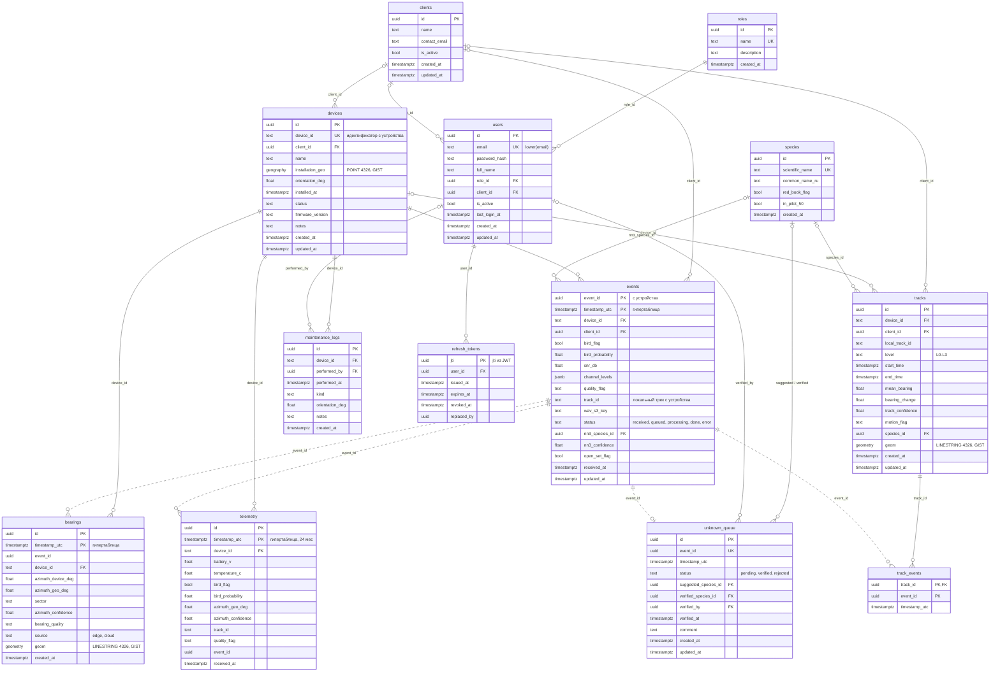

# ER-диаграмма схемы MVP

Источник — миграции `migrations/versions/0001`–`0006`. Требования — `doc_v2/AI_AGENTS_SPEC.md` §4.1.

Сплошная связь — внешний ключ в БД. Пунктир — ссылка по `event_id` и `timestamp_utc` без внешнего ключа: `events` — гипертаблица TimescaleDB с составным ключом.

`events`, `bearings` и `telemetry` — гипертаблицы, чанки по 1 неделе. Телеметрия хранится 24 месяца. WAV в объектном хранилище — 12 месяцев, правилом бакета.

